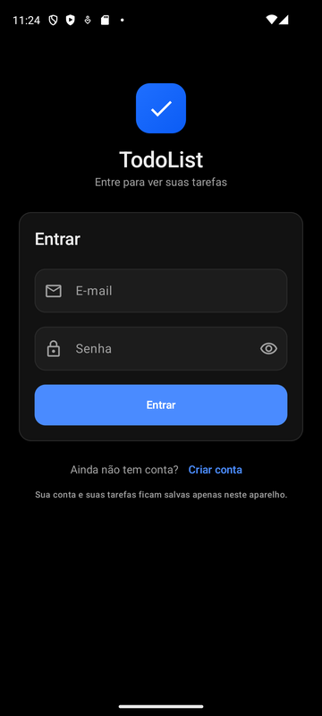
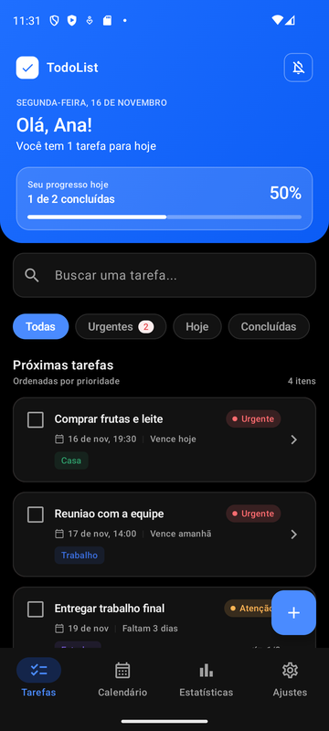
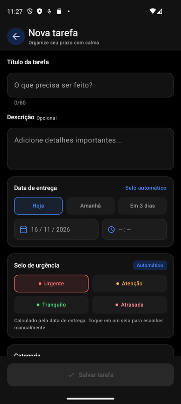
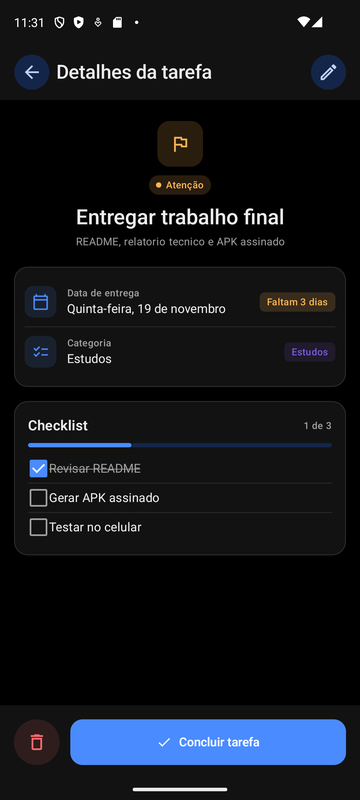
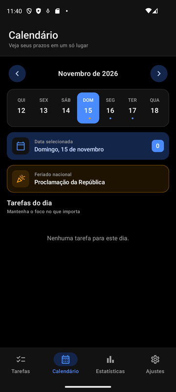
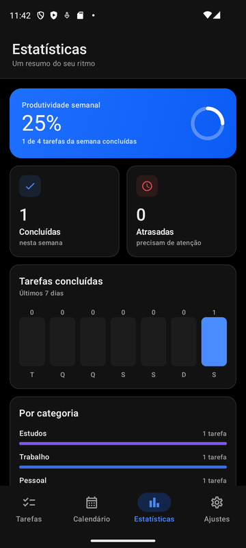
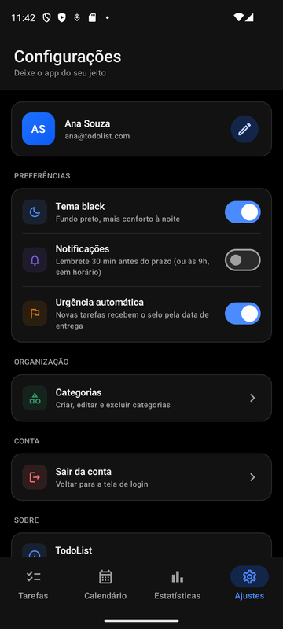

# TodoList

Aplicativo Android de organização pessoal: tarefas com prazo, categorias, subtarefas, lembretes, calendário com feriados nacionais e estatísticas de produtividade.

Trabalho final da disciplina **Programação Mobile** — UNASP-SP, 2026/2.
Desenvolvido em **Kotlin** com **Jetpack Compose** e **Material Design 3**.

<p>
  
  
  
  
</p>
<p>
  
  
  
</p>

## Funcionalidades

- **Contas locais**: cadastro e login no próprio aparelho (senha guardada como hash PBKDF2). Cada usuário só vê as próprias tarefas e categorias.
- **Tarefas**: criar, editar, excluir (botão ou arrastar o card), concluir e reabrir. Título, descrição, data e horário, categoria e subtarefas (checklist).
- **Selo de urgência**: automático pela data de entrega (Atrasada, Urgente, Atenção, Tranquilo) ou escolhido manualmente.
- **Busca e filtros**: Todas, Urgentes, Hoje e Concluídas, com a lista ordenada por prioridade.
- **Categorias**: 4 categorias padrão e uma tela para criar, editar (nome e cor) e excluir.
- **Calendário**: faixa semanal com as tarefas de cada dia e os **feriados nacionais** vindos da BrasilAPI, que ficam salvos para uso sem internet.
- **Lembretes**: notificação 30 minutos antes do horário da tarefa (ou às 9h, se a tarefa não tiver horário), com pedido de permissão no Android 13+.
- **Estatísticas**: produtividade da semana, concluídas e atrasadas, gráfico dos últimos 7 dias e tarefas por categoria.
- **Tema black** (padrão) e tema claro.

## Requisitos

| Para | Precisa de |
|---|---|
| Instalar o APK | Android 8.0 (API 26) ou superior |
| Compilar o projeto | Android Studio recente (com JBR 21+), Android SDK 37 |
| Feriados no calendário | Internet no primeiro acesso de cada ano (depois funciona offline) |

## Instalação (APK)

1. Baixe o `TodoList-v1.0.apk` assinado entregue junto com o trabalho.
2. No celular, permita a instalação de apps de fontes desconhecidas para o navegador ou gerenciador de arquivos.
3. Abra o APK e toque em **Instalar**.
4. Crie uma conta na primeira tela. A conta fica salva apenas naquele aparelho.

Pelo computador, com o celular ou emulador conectado: `adb install TodoList-v1.0.apk`.

## Executar a partir do código

1. Clone o repositório e abra a pasta **`Projeto ToDo`** no Android Studio (*File › Open*).
2. Aguarde o *Gradle Sync*.
3. Escolha um emulador ou celular e clique em **Run ▶**.

Pelo terminal (Windows), com `JAVA_HOME` apontando para o JBR do Android Studio:

```bat
set JAVA_HOME=C:\Program Files\Android\Android Studio\jbr
gradlew assembleDebug testDebugUnitTest
```

> **Pasta com acentos:** se o caminho do projeto tiver acentos (ex.: OneDrive "Instituição"), o build é redirecionado automaticamente para `%USERPROFILE%\.todolist-build`. O APK de debug fica em `%USERPROFILE%\.todolist-build\_app\outputs\apk\debug\`.

### Gerar o APK assinado

A assinatura usa uma chave guardada **fora do repositório**, em `%USERPROFILE%\.todolist-keys\` (`todolist-release.jks` e `keystore.properties`). Com esses arquivos na máquina:

```bat
gradlew assembleRelease
```

O APK sai em `%USERPROFILE%\.todolist-build\_app\outputs\apk\release\app-release.apk`. Sem a chave, o release é gerado sem assinatura. Para uma chave nova, use *Build › Generate Signed App Bundle or APK* no Android Studio.

## Arquitetura e tecnologias

**MVVM + Repository** em camadas: `ui` (telas Compose e ViewModels), `domain` (modelos e regras, como urgência e lembretes) e `data` (Room, DataStore, rede e repositórios).

| Item | Uso |
|---|---|
| Jetpack Compose + Material 3 | Interface |
| Navigation Compose | Bottom Navigation e rotas internas |
| ViewModel + Coroutines/Flow | Estado das telas |
| Room 2.8 | Banco local (usuários, categorias, tarefas, subtarefas, feriados) |
| DataStore | Sessão e preferências |
| Ktor 3.3 + kotlinx.serialization | Consumo da BrasilAPI |
| WorkManager | Agendamento dos lembretes |

**API externa:** [BrasilAPI — Feriados nacionais](https://brasilapi.com.br/docs#tag/Feriados-Nacionais) (`GET /api/feriados/v1/{ano}`). É gratuita e não usa chave. Falhas de rede mostram uma mensagem e o botão "Tentar de novo", sem travar o calendário.

## Testes

- **Unitários** (`gradlew testDebugUnitTest`): 16 testes, cobrindo regras de urgência, validação e hash de senha, regras de lembrete e o repositório de feriados com servidor simulado (sucesso, cache, erro do servidor, ano inexistente, sem internet e chamada travada).
- **Manuais** no emulador Pixel 8 (Android 14): registrados em [`Instruções/PROGRESSO_TodoList.md`](Instruções/PROGRESSO_TodoList.md).

## Limitações conhecidas

- As contas são locais: não há servidor nem sincronização entre aparelhos.
- Os lembretes usam WorkManager, então o horário é aproximado (o Android pode atrasar alguns minutos em economia de bateria).
- A integração com Google Agenda e ClickUp, prevista no planejamento, não foi implementada.

## Criadores

Guilherme Oliveira · Kaue Bueno · Pedro Henrique Gomes · Vinicius Borges · Lucas Cardoso · Henrique Gomes
